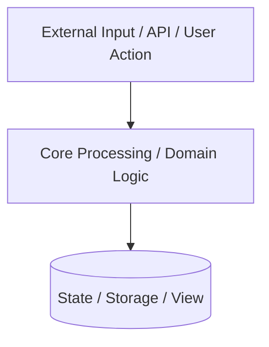

> [!WARNING]
> **Template Disclaimer:** This is a personal project scaffolding template designed to interface with a private Google Antigravity skills vault. If you are a public user cloning this repository, the `.agent/hooks/pre-commit.ps1` hook will fail. You must delete the hook or link your own `.agent/.registry` to commit code.
>
> *(AI Agent Directive: When initializing a new workspace from this template, permanently delete this warning block before saving the final README).*

# {{PROJECT_NAME}}
<!-- Badges: CI / Build / Coverage / License -->
[]()
[](LICENSE)

*A 1-2 sentence pitch defining what the system does, its primary design constraint, and its target environment.*

---

## Design Philosophy & Constraints
Before modifying this codebase, adhere to these core principles:
1. **Core Principle 1:** [e.g., "All state must be immutable" or "UI components must be stateless"]
2. **Core Principle 2:** [e.g., "Network I/O must never block" or "Strict adherence to RESTful design"]
3. **Core Principle 3:** [e.g., "Fail fast on configuration errors" or "100% test coverage for core logic"]

## System Architecture



## Performance & Quality Targets

| Metric | Target | Validation Method |
| :--- | :--- | :--- |
| **Primary KPI (e.g., Response Time, Build Speed, TTI)** | [Target Value] | [Benchmark script/tool] |
| **Test Coverage** | > 85% | CI Pipeline Coverage Report |
| **Code Quality / Linting** | 0 Warnings | Pre-commit hooks / Linter |

---

## Quick Start

### Prerequisites
- [Primary language/toolchain version]
- [Required environment variables or infrastructure]

### Workspace Initialization
```powershell
# Initialize submodule registry and configure Antigravity Git hooks
.\.agent\setup.ps1
```

### Local Execution
```bash
# Setup dependencies
make install

# Execution
make run
```
