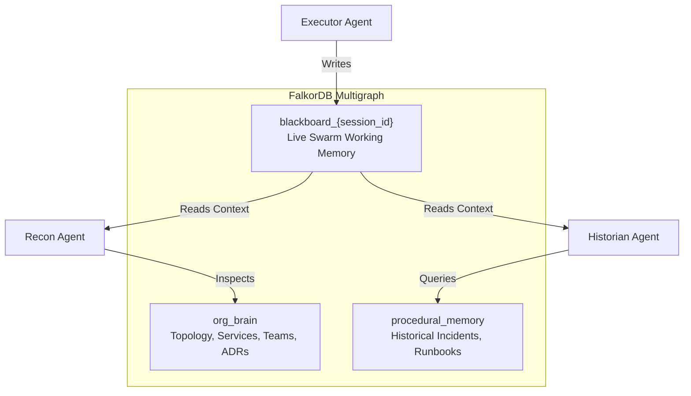

# NexusGraph Multigraph Architecture

NexusGraph structures organizational knowledge, incident memory, and multi-agent reasoning into isolated graph namespaces powered by FalkorDB.



## 1. Multigraph Namespace Isolation

NexusGraph enforces strict data isolation across three operational graph tiers:

1. **`org_brain`**: Static and slowly-evolving structural topology:
   - Microservice dependency graphs (`(:Service)-[:DEPENDS_ON]->(:Service)`)
   - Ownership models (`(:Team)-[:OWNS]->(:Service)`, `(:Person)-[:MEMBER_OF]->(:Team)`)
   - Architectural decisions (`(:Person)-[:DECIDED]->(:ADR)-[:GOVERNS]->(:Service)`)
   - Deployment provenance (`(:Commit)-[:DEPLOYED_TO]->(:Service)`)

2. **`procedural_memory`**: Episodic incident history and organizational learning:
   - Root-cause incident nodes (`(:Incident)-[:AFFECTED]->(:Service)`)
   - Symptom pattern signatures (`(:Incident)-[:EXHIBITED]->(:Pattern)`)
   - Verified remediation steps (`(:Pattern)-[:RESOLVED_BY]->(:RunbookStep)`)

3. **`blackboard_<session_id>`**: Ephemeral, per-investigation multi-agent workspace:
   - Atomic reasoning tasks (`(:Task {status: 'COMPLETED'})`)
   - Diagnostic findings (`(:Finding)-[:INDICATES]->(:Service)`)
   - Proposed remediations (`(:ProposedAction)-[:TARGETS]->(:Commit)`)

## 2. Ingestion & Export Interfaces

The local repository wiki (`wiki/`) serves as a markdown-based source of truth for architectural records and runbooks. It exports directly into FalkorDB via openCypher:

```bash
powershell -File .\.agent\wiki.ps1 --root wiki export --format cypher --output wiki-graph.cypher
```

Exported Cypher commands merge seamlessly into `org_brain` without requiring proprietary schema transformations.

## 3. Related Documents
- Entry Index: [[wiki/index]] (relates_to)
- Architectural Decision: [[wiki/adr/001-falkordb-backend]] (governed_by)
- Swarm Coordination Specification: [[wiki/specs/agent-swarm]] (implements)
