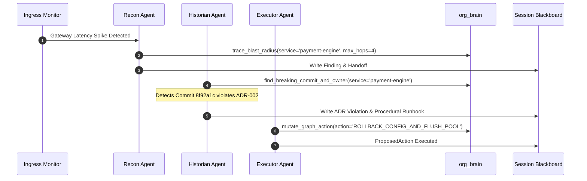

# Runbook: Cascading Timeout & Thread Exhaustion Remediation

## Symptom Signature: `cascading-timeout-ledger`
- **Observed Alert**: Ingress HTTP 504 Gateway Timeouts at `api-gateway`.
- **Downstream Root Cause**: `payment-engine` worker pool exhaustion caused by misconfigured 5000ms socket timeouts targeting `ledger-db`.
- **Historical Reference**: `INC-2025-104` in `procedural_memory`.

## Automated Tri-Agent Remediation Sequence



## Step-by-Step Remediation Actions

1. **Isolate Breaking Commit**:
   - Query commit lineage using `find_breaking_commit_and_owner`.
   - Identify commit SHA `8f92a1c` authored by Arjun Mehta (`@arjun`).
   - Validate policy conflict against [[wiki/adr/002-ledger-grpc-timeout]].

2. **Rollback & Connection Pool Flush**:
   - Revert commit `8f92a1c` to restore the 200ms timeout ceiling.
   - Flush active client connection pools on `payment-engine` to drop hanging sockets.
   - Command template:
     ```bash
     git revert 8f92a1c --no-edit
     curl -X POST http://payment-engine:8080/internal/pools/flush
     ```

3. **Graph State Mutation**:
   - Execute `mutate_graph_action` to reset `payment-engine` status to `HEALTHY`.
   - Record `ProposedAction` in `blackboard_<session_id>`.
   - Increment confidence score on `(:Pattern)-[:RESOLVED_BY]->(:RunbookStep)` in `procedural_memory`.

## References
- ADR 002 Policy: [[wiki/adr/002-ledger-grpc-timeout]] (mitigates)
- Swarm Protocol: [[wiki/specs/agent-swarm]] (implements)
- FastMCP Tools: [[wiki/specs/mcp-graph-tools]] (relates_to)
- Testing Runbook: [[wiki/runbooks/verification-and-testing]] (relates_to)
- Entry Index: [[wiki/index]] (relates_to)
