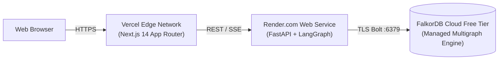

# Runbook: Zero-Cost Production Deployment Guide

NexusGraph is engineered to run seamlessly on modern zero-cost cloud tiers with no credit card required and zero ongoing infrastructure fees.

## Target Architecture



| Component | Cloud Provider & Tier | Cost | Invariants & Features |
| :--- | :--- | :--- | :--- |
| **Graph Database** | **FalkorDB Cloud** (Free Tier) | $0.00 / mo | 24/7 persistent uptime, TLS encryption, GraphBLAS Cypher engine. |
| **Backend API** | **Render.com** (Free Web Service) | $0.00 / mo | Automated HTTPS, SSE streaming support, auto-deploy from Git. |
| **Frontend UI** | **Vercel** (Hobby Tier) | $0.00 / mo | Global Edge CDN, sub-second TTFB, zero cold starts for Next.js. |

---

## Step 1: Provision FalkorDB Cloud Free Tier

1. Navigate to [app.falkordb.cloud](https://app.falkordb.cloud/) and create a free account (no credit card required).
2. Click **Create Database** and select the **Free Tier**.
3. Choose your preferred cloud provider and region (e.g., AWS us-east-1).
4. Once provisioned, note the connection credentials from the database details pane:
   - **Host:** e.g., `db-xyz.falkordb.cloud`
   - **Port:** e.g., `12345`
   - **Password:** `<your-database-password>`
   - **TLS / SSL:** `Enabled`

---

## Step 2: Deploy Backend Service to Render

### Option 2A: 1-Click Render Blueprint
1. Fork or push this repository to your GitHub account.
2. In Render, select **New +** $\rightarrow$ **Blueprint**.
3. Connect your GitHub repository containing [`render.yaml`](file:///c:/Users/Bhatn/OneDrive/Desktop/Projects/github/nexusgraph/render.yaml).
4. Fill in the prompted secret environment variables:
   - `FALKORDB_HOST`: Your FalkorDB Cloud host
   - `FALKORDB_PORT`: Your FalkorDB Cloud port
   - `FALKORDB_PASSWORD`: Your FalkorDB Cloud password
   - `FALKORDB_SSL`: `true`
5. Click **Apply**. Render will automatically build the container and issue a public URL (e.g., `https://nexusgraph-backend.onrender.com`).

### Option 2B: Manual Render Web Service
1. In Render, select **New +** $\rightarrow$ **Web Service**.
2. Connect your repository.
3. Configure settings:
   - **Root Directory:** `backend`
   - **Runtime:** `Python`
   - **Build Command:** `pip install -r requirements.txt`
   - **Start Command:** `uvicorn app.main:app --host 0.0.0.0 --port $PORT`
   - **Plan:** `Free`
4. In **Environment Variables**, add:
   ```env
   FALKORDB_HOST=db-xyz.falkordb.cloud
   FALKORDB_PORT=12345
   FALKORDB_PASSWORD=<your-falkordb-password>
   FALKORDB_SSL=true
   SEED_ON_STARTUP=true
   LOG_LEVEL=info
   ```
5. Deploy the service and verify healthy startup at `https://<your-backend>.onrender.com/api/health`.

---

## Step 3: Deploy Frontend Dashboard to Vercel

1. Navigate to [vercel.com](https://vercel.com/) and click **Add New Project**.
2. Import your GitHub repository.
3. In project setup:
   - **Framework Preset:** `Next.js`
   - **Root Directory:** Click **Edit** and select `frontend`.
4. In **Environment Variables**, configure:
   ```env
   NEXT_PUBLIC_API_URL=https://nexusgraph-v8n0.onrender.com
   ```
5. Click **Deploy**. Vercel builds and assigns the global production URL: [`https://nexusgraph-mu.vercel.app`](https://nexusgraph-mu.vercel.app/).

---

## Step 4: Live Verification Runbook

1. **Verify Backend Status:**
   ```bash
   curl -s https://nexusgraph-v8n0.onrender.com/api/health
   ```
   Expected response:
   ```json
   {
     "status": "healthy",
     "service": "NexusGraph Swarm Engine",
     "falkordb_host": "r-6jissuruar.instance-k5i62m7ep.hc-7up0crkyn.ap-south-1.aws.f2e0a955bb84.cloud:64801",
     "schema_status": {
       "engine": "FalkorDB (Native Bolt)",
       "native_connected": true,
       "graphs": {
         "org_brain": "ready",
         "procedural_memory": "ready",
         "blackboard": "ready"
       }
     }
   }
   ```

2. **Verify Frontend Live Graph:**
   - Open [`https://nexusgraph-mu.vercel.app`](https://nexusgraph-mu.vercel.app/) in your browser.
   - Confirm the status pill displays `Engine: FalkorDB (Bolt :6379)` with a pulsing indicator.
   - Click **Run** on Scenario 1 (*Cascading Timeout & Breaking Commit*).
   - Observe real-time SSE streaming and graph path illumination over TLS.

---

## Step 5: Self-Hosted Alternative (Free Cloud VM / VPS)

If you prefer a single-server deployment (e.g., Oracle Cloud Always Free 4-OCPU 24GB ARM instance or GCP `e2-micro`), launch the entire stack in one command via Docker Compose:

```bash
git clone https://github.com/Awesome06/nexusgraph.git
cd nexusgraph
docker compose up -d --build
```

Access points:
- Frontend: `http://<server-ip>:3001`
- Backend API Docs: `http://<server-ip>:8000/docs`
- FalkorDB Browser: `http://<server-ip>:3000`

---

## Related Documents
- Entry Index: [[wiki/index]] (relates_to)
- System Architecture: [[wiki/architecture]] (implements)
- Verification Runbook: [[wiki/runbooks/verification-and-testing]] (relates_to)
