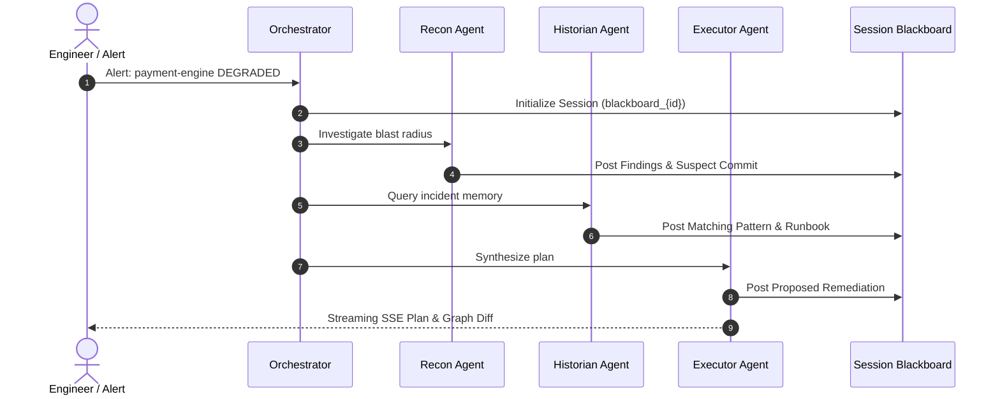

# Multi-Agent Swarm Coordination Protocol

NexusGraph deploys a specialized tri-agent swarm to investigate production incidents, correlate historical patterns, and propose verified remediations without human latency.

## 1. Swarm Specialization & Agent Roles

1. **Reconnaissance Agent (`ReconAgent`)**:
   - Queries `org_brain` to construct the active blast radius starting from the alert's anchor service.
   - Traces upstream and downstream dependencies up to 3 hops.
   - Identifies recent code commits, authors, and configuration changes deployed within the incident window.

2. **Historian Agent (`HistorianAgent`)**:
   - Queries `procedural_memory` for episodic recall.
   - Evaluates symptom patterns against historical post-mortems and past incident graphs.
   - Retrieves verified runbook steps and past resolution outcomes.

3. **Execution Agent (`ExecutorAgent`)**:
   - Synthesizes findings and patterns posted to the session blackboard.
   - Formulates deterministic, stepped remediation plans (e.g. feature-flag rollback, traffic re-routing).
   - Generates interactive graph diffs and Cypher mutations for human-in-the-loop approval.

## 2. Invariants & Guardrails
- **Isolation Guarantee**: Agents NEVER write intermediate thoughts to `org_brain` or `procedural_memory`. All working hypotheses are scoped exclusively to `blackboard_<session_id>`.
- **Zero Hallucination Protocol**: Remediation actions must reference verified graph nodes (Commit SHA, Service Name, Runbook ID) confirmed by Cypher queries.

## 3. Related Documents
- System Architecture: [[wiki/architecture]] (implements)
- Architectural Decision: [[wiki/adr/001-falkordb-backend]] (relates_to)
- Entry Index: [[wiki/index]] (relates_to)
