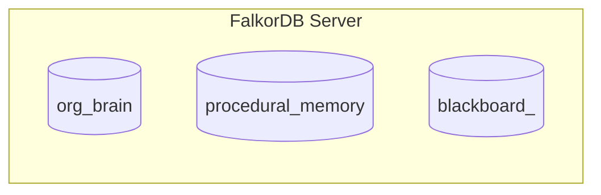

# Specification: FalkorDB Multigraph Namespaces & Schema

NexusGraph enforces strict schema partitioning by organizing operational data into three isolated graph namespaces managed by `FalkorManager.select_graph()`.

## Graph Namespace Definitions

### 1. `org_brain`
Persistent organizational brain containing topology, team ownership, commits, and governance policies:
- **Nodes**:
  - `(:Service {name, tier, status, language, pagerank_score})`
  - `(:Team {name, oncall_channel})`
  - `(:Person {id, name, role, slack_handle, timezone})`
  - `(:Commit {sha, message, timestamp, files_changed})`
  - `(:ADR {id, title, status, rule_summary, created_at})`
- **Edges**:
  - `(:Service)-[:DEPENDS_ON {criticality, protocol}]->(:Service)`
  - `(:Team)-[:OWNS]->(:Service)`
  - `(:Person)-[:MEMBER_OF]->(:Team)`
  - `(:Person)-[:AUTHORED]->(:Commit)-[:DEPLOYED_TO]->(:Service)`
  - `(:Person)-[:DECIDED]->(:ADR)-[:GOVERNS]->(:Service)`

### 2. `procedural_memory`
Episodic memory across historical incidents and resolution runbooks:
- **Nodes**:
  - `(:Incident {id, title, root_cause_commit, resolved_at})`
  - `(:Pattern {symptom_signature})`
  - `(:RunbookStep {id, command_template})`
- **Edges**:
  - `(:Incident)-[:AFFECTED]->(:Service)`
  - `(:Incident)-[:EXHIBITED]->(:Pattern)`
  - `(:Pattern)-[:RESOLVED_BY {confidence, times_used}]->(:RunbookStep)`

### 3. `blackboard_<session_id>`
Ephemeral per-investigation blackboard providing isolated working memory for the agent swarm:
- **Nodes**:
  - `(:Finding {id, agent_name, summary, cypher_used, timestamp})`
  - `(:Task {id, description, status})`
  - `(:ProposedAction {id, action_type, target_service, risk_score, approved, executed_at})`
- **Edges**:
  - `(:Finding)-[:HANDOFF_TO {next_agent}]->(:Task)`
  - `(:Finding)-[:SUPPORTS]->(:ProposedAction)`

## Indexing & Performance
Property indexes are initialized at application startup on `Service(name)`, `Commit(sha)`, `Person(name)`, `Pattern(symptom_signature)`, and `Finding(id)` to guarantee sub-millisecond query execution.

## References
- Architecture: [[wiki/architecture]] (relates_to)
- FastMCP Tools: [[wiki/specs/mcp-graph-tools]] (relates_to)
- Synthetic Topology: [[wiki/specs/synthetic-topology]] (relates_to)
- Entry Index: [[wiki/index]] (relates_to)
